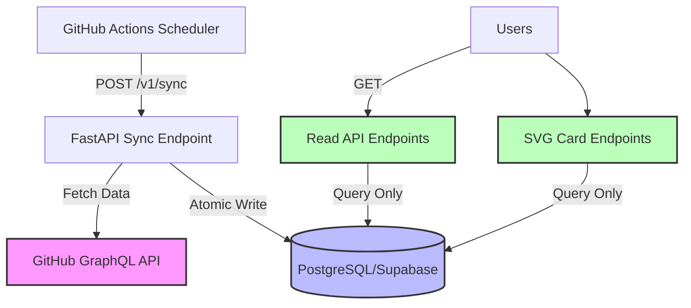
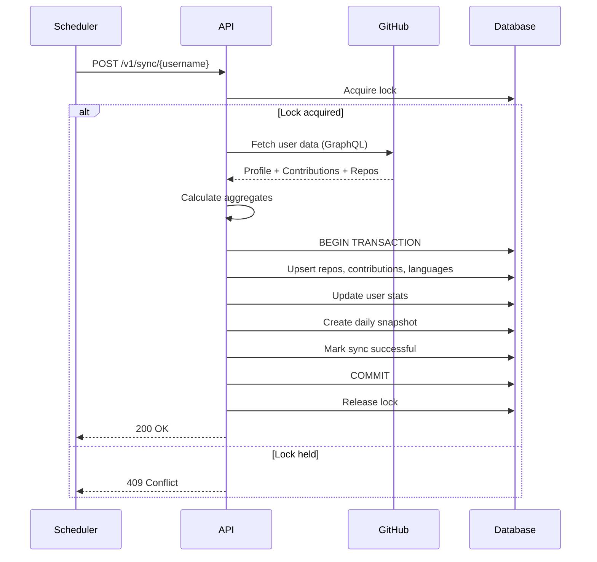

# GitHub Stats Service

A production-quality, lightweight GitHub statistics service for GitHub README profiles. Periodically synchronizes GitHub data into PostgreSQL, precomputes all statistics, and exposes a fast read-only API with SVG cards.

## Key Architectural Property

> **The read path NEVER depends on GitHub being available.**

GitHub is the external source of truth. PostgreSQL is the application's source of truth for serving data. Failed synchronization never corrupts or partially replaces previously valid user-facing data.

## Architecture



### Core Principles

1. **GET requests NEVER call GitHub** - All reads come from PostgreSQL
2. **Atomic synchronization** - All database writes happen in one transaction
3. **Failure resilience** - GitHub failures never erase valid data
4. **Lock-based concurrency** - Prevents overlapping syncs for the same user
5. **Stateless deployment** - Runs on Vercel serverless functions
6. **CDN caching** - HTTP cache headers optimize response times

## Technology Stack

- **Backend**: Python 3.12, FastAPI
- **Database**: PostgreSQL (Supabase)
- **GitHub API**: GraphQL (primary), REST (language details)
- **Database Driver**: psycopg 3.x with connection pooling
- **Migrations**: Alembic
- **Testing**: pytest
- **Deployment**: Vercel (serverless)
- **Scheduler**: GitHub Actions

## Database Schema

### users
Stores GitHub profile and precomputed statistics.
- Primary key: `username`
- Statistics: commits, PRs, issues, reviews, streaks, stars, etc.

### repositories
Stores repository metadata.
- Primary key: `github_id`
- Tracks: stars, forks, language, pushed_at

### contribution_days
Stores daily contribution counts from GitHub's contribution calendar.
- Composite key: `(username, date)`

### language_totals
Stores language byte counts aggregated across repositories.
- Composite key: `(username, language)`

### daily_snapshots
Historical snapshots for trend analysis.
- Composite key: `(username, date)`

### sync_state
Tracks synchronization state and locking.
- Primary key: `username`
- Status: `ok` | `degraded` | `failing`

## Synchronization Flow



### Sync Process

1. **Acquire lock** - Prevents concurrent syncs
2. **Fetch GitHub data** - Outside database transaction
3. **Calculate aggregates** - Streaks, totals, percentages
4. **Atomic database update**:
   - Upsert repositories
   - Upsert contribution days
   - Update user statistics
   - Create daily snapshot
   - Mark sync successful
5. **Release lock**

On failure:
- Transaction rolls back automatically
- Previous data remains intact
- Failure metadata recorded separately
- Status becomes `degraded` after 3 consecutive failures

## API Endpoints

### Synchronization

#### `POST /v1/sync/{username}`
Trigger synchronization for a user (authenticated).

**Authentication**: `Authorization: Bearer <SYNC_SECRET>`

**Response**:
```json
{
  "username": "PrajwalAmte",
  "status": "success",
  "message": "Synchronization completed successfully",
  "repositories_synced": 42,
  "contribution_days": 365
}
```

### Statistics

#### `GET /v1/users/{username}/stats`
Get aggregated user statistics.

**Response**:
```json
{
  "data": {
    "username": "PrajwalAmte",
    "total_commits": 4213,
    "total_pull_requests": 83,
    "total_issues": 27,
    "total_reviews": 142,
    "current_streak": 12,
    "longest_streak": 73,
    "contribution_count": 642,
    "repository_count": 42,
    "star_count": 184,
    "fork_count": 31
  },
  "meta": {
    "generated_at": "2026-08-22T20:00:00Z",
    "last_sync": "2026-08-22T18:04:11Z",
    "sync_status": "ok"
  }
}
```

#### `GET /v1/users/{username}/languages`
Get language distribution.

#### `GET /v1/users/{username}/history?from=2026-01-01&to=2026-08-22`
Get historical daily snapshots (max 365 days).

### SVG Cards

#### `GET /v1/users/{username}/cards/profile.svg`
Profile statistics card.

#### `GET /v1/users/{username}/cards/streak.svg`
Contribution streak card.

**Example usage in README**:
```markdown


```

### Health

#### `GET /health`
Basic health check - service is responding.

#### `GET /ready`
Readiness check - database connected and data available.

## Metric Definitions

| Metric | Definition |
|--------|------------|
| `total_commits` | GitHub's `totalCommitContributions` |
| `total_pull_requests` | GitHub's `totalPullRequestContributions` |
| `total_issues` | GitHub's `totalIssueContributions` |
| `total_reviews` | GitHub's `totalPullRequestReviewContributions` |
| `contribution_count` | Sum of all contribution calendar counts |
| `current_streak` | Consecutive days with contributions ending today/yesterday |
| `longest_streak` | Longest historical sequence of contribution days |
| `star_count` | Total stars across all owned repositories |
| `repository_count` | Number of owned (non-fork) repositories |

## Local Development

### Prerequisites

- Python 3.12+
- PostgreSQL (or Supabase account)
- GitHub Personal Access Token

### Setup

1. **Clone and install dependencies**:
```bash
cd github-stats
python -m venv venv
source venv/bin/activate  # On Windows: venv\Scripts\activate
pip install -r requirements.txt
```

2. **Configure environment**:
```bash
cp .env.example .env
# Edit .env with your values
```

Required environment variables:
- `DATABASE_URL`: PostgreSQL connection string
- `GITHUB_TOKEN`: GitHub personal access token
- `SYNC_SECRET`: Random secret for sync authentication

3. **Run migrations**:
```bash
alembic upgrade head
```

4. **Start development server**:
```bash
uvicorn app.main:app --reload
```

### Running Tests

```bash
pytest
```

### Code Quality

```bash
# Format and lint
ruff check app/ tests/
ruff format app/ tests/

# Type checking
mypy app/
```

## Deployment

### Supabase Setup

1. Create a Supabase project
2. Get the PostgreSQL connection string (use "Connection pooling" URL for serverless)
3. Run migrations:
```bash
alembic upgrade head
```

### Vercel Deployment

1. **Install Vercel CLI**:
```bash
npm install -g vercel
```

2. **Deploy**:
```bash
vercel
```

3. **Configure environment variables** in Vercel dashboard:
   - `DATABASE_URL`
   - `GITHUB_TOKEN`
   - `SYNC_SECRET`

4. **Note your deployment URL** (e.g., `https://your-project.vercel.app`)

### GitHub Actions Setup

1. **Add secrets** to your GitHub repository:
   - `API_URL`: Your Vercel deployment URL
   - `SYNC_SECRET`: Same as in Vercel

2. **The workflow** (`.github/workflows/sync.yml`) will:
   - Run every 3 hours automatically
   - Allow manual triggers via `workflow_dispatch`
   - Sync the configured username (default: PrajwalAmte)

3. **Customize the username** in `.github/workflows/sync.yml` if needed

## GitHub Token Requirements

Create a GitHub Personal Access Token with these scopes:
- `read:user` - Read profile information
- `repo` (public repositories) - Read repository data

**No write permissions needed** - this service only reads data.

## Failure Behavior

| Scenario | Behavior |
|----------|----------|
| GitHub down | Old data keeps serving, `sync_status: degraded` after 3 failures |
| Database error during sync | Transaction rolls back, no data corruption |
| Concurrent sync | Second request returns 409, first proceeds |
| Sync crashes mid-write | Transaction rolls back, previous data intact |

## HTTP Caching

All GET endpoints include:
```
Cache-Control: public, s-maxage=3600, stale-while-revalidate=86400
```

- CDN caches responses for 1 hour
- Stale content served while revalidating for 24 hours
- Dramatically reduces response times globally

## Monitoring

Check sync health:
1. **Sync status** in API responses (`meta.sync_status`)
2. **Last sync timestamp** in API responses (`meta.last_sync`)
3. **GitHub Actions logs** for sync failures
4. **Readiness endpoint** (`/ready`) for automated health checks

## Project Structure

```
github-stats/
├── app/
│   ├── main.py              # FastAPI application
│   ├── config.py            # Configuration management
│   ├── exceptions.py        # Custom exceptions
│   ├── api/                 # API route handlers
│   │   ├── routes_sync.py
│   │   ├── routes_stats.py
│   │   ├── routes_cards.py
│   │   └── routes_health.py
│   ├── github/              # GitHub API client
│   │   ├── client.py
│   │   ├── queries.py
│   │   └── models.py
│   ├── db/                  # Database layer
│   │   ├── connection.py
│   │   ├── models.py
│   │   └── repositories.py
│   ├── sync/                # Synchronization service
│   │   └── service.py
│   ├── stats/               # Statistics calculations
│   │   ├── streaks.py
│   │   ├── languages.py
│   │   └── metrics.py
│   └── cards/               # SVG card rendering
│       ├── profile.py
│       └── streak.py
├── migrations/              # Alembic migrations
├── tests/                   # Test suite
├── .github/workflows/       # GitHub Actions
├── requirements.txt
├── pyproject.toml
├── vercel.json
└── README.md
```

## License

MIT License - feel free to use this for your own GitHub profile!

## Contributing

Contributions welcome! Please:
1. Fork the repository
2. Create a feature branch
3. Write tests for new functionality
4. Submit a pull request

## Support

For issues or questions:
- Open an issue on GitHub
- Check existing documentation
- Review the architectural constraints in `To-Do.md`
