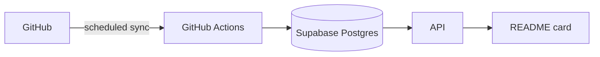

# GitHub Stats

[](https://github.com/PrajwalAmte/Github-Stats/actions/workflows/ci.yml)
[](https://github.com/PrajwalAmte/Github-Stats/actions/workflows/sync.yml)
[](LICENSE)

Dynamic GitHub statistics cards for your profile README — precomputed, cached at the edge, and never blocked on GitHub's API being up.

<picture>
  <source media="(prefers-color-scheme: dark)" srcset="https://github-stats-green-one.vercel.app/v1/users/PrajwalAmte/cards/overview.svg?t=1">
  
</picture>

## Usage

Add this to your README, swapping in your username:

```markdown
<picture>
  <source media="(prefers-color-scheme: dark)" srcset="https://github-stats-green-one.vercel.app/v1/users/YOUR-USERNAME/cards/overview.svg">
  
</picture>
```

That's it — cards render for any synced user on the hosted instance. No account, no setup.

### Available cards

```text
GET /v1/users/{username}/cards/overview.svg
GET /v1/users/{username}/cards/profile.svg
GET /v1/users/{username}/cards/streak.svg
GET /v1/users/{username}/cards/languages.svg
```

### Raw data, if you want it

```text
GET /v1/users/{username}/stats
GET /v1/users/{username}/languages
GET /v1/users/{username}/history
```

---

## Architecture — and why it's reliable



The one rule everything else follows from: **a card request never talks to GitHub.** Stats are pulled on a schedule, precomputed, and written to Postgres. Every read — the JSON endpoints and the SVG cards — only ever queries that database.

What that buys you:

| If this fails | What happens |
|---|---|
| GitHub is down or rate-limited | Cards keep rendering from the last successful sync |
| A sync run crashes partway through | Nothing — writes are transactional, so a failed sync never leaves partial data |
| Two syncs get triggered at once | The second is rejected (a lock prevents concurrent writes); it doesn't corrupt anything |
| The scheduler misses a run | Data goes stale, not wrong — every response includes `last_sync` so staleness is visible, never silent |

There's deliberately no cache layer beyond the CDN — Postgres already holds precomputed data, so a database read is fast enough on its own. One less service that can go down.

---

## Contributing

Issues and PRs welcome — bug fixes, new card designs, additional stats, anything. Open an issue first for larger changes so we can align on approach before you put the work in.

## Tech Stack

Python 3.12 · FastAPI · PostgreSQL · SQLAlchemy · Supabase · Vercel

## License

MIT